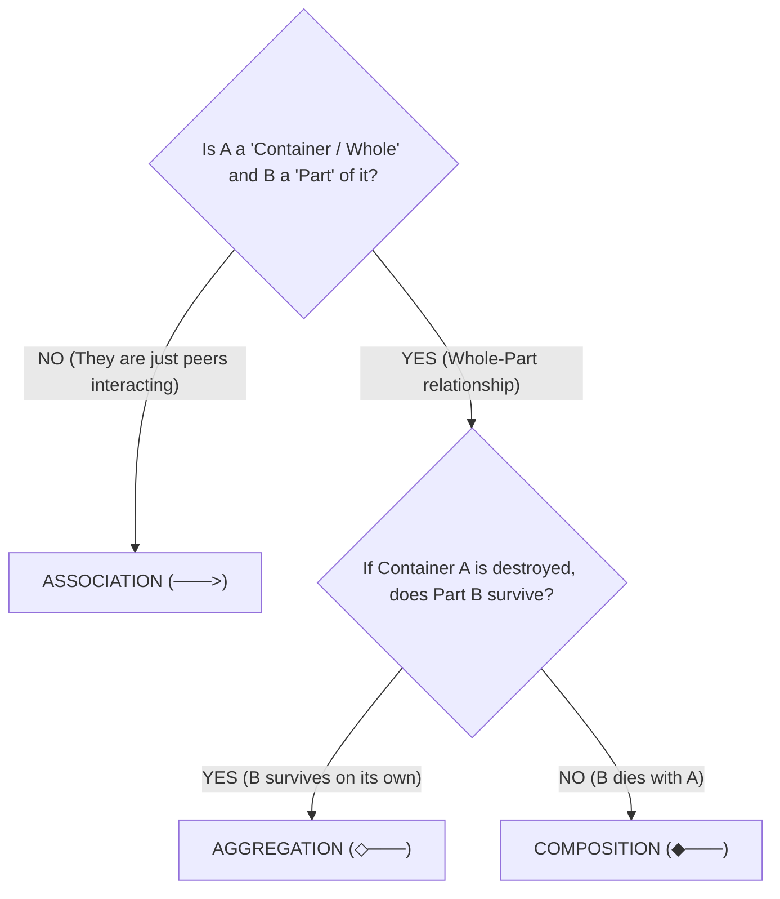
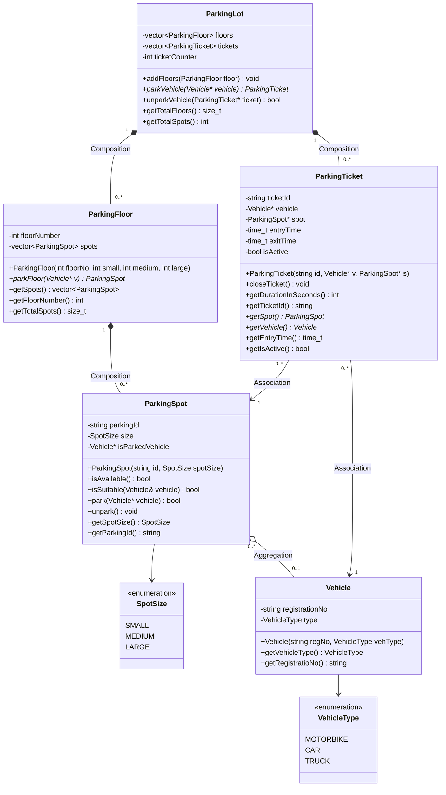
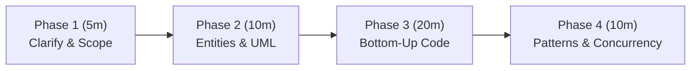

# UML Class Diagram — Relationships & Multiplicity

---

## 1. Relationships

### 1.1 Inheritance (Generalization) — "IS-A"
> Child **is a** type of Parent. Child inherits all parent behavior.

**Notation:** Solid line + **hollow triangle arrowhead** pointing to parent

```
Animal ◁────── Dog
```

**C++ Code:**
```cpp
class Dog : public Animal {};
```

**Example:** `Dog` IS-A `Animal`, `UPIProcessor` IS-A `PaymentGateway`

---

### 1.2 Realization (Interface Implementation) — "CAN-DO"
> Class implements an interface/abstract class.

**Notation:** Dashed line + **hollow triangle arrowhead** pointing to interface

```
«interface»
Payable ◁- - - - CreditCard
```

**C++ Code:**
```cpp
class CreditCard : public Payable {};  // Payable is pure abstract
```

**Example:** `CardProcessor` realizes `PaymentGateway` (pure virtual)

---

### 1.3 Association — "USES-A" / "KNOWS-A"
> One class **uses** another. Most general relationship.

**Notation:** Solid line, optional open arrowhead for direction

```
Customer ────────> Order
```

**C++ Code:**
```cpp
class Customer {
    Order* order;   // just knows about Order
};
```

**Example:** `Student` and `Course` — student uses/attends a course

---

### 1.4 Aggregation — "HAS-A" (Weak)
> One class **contains** another, but child **can exist independently**.

**Notation:** Solid line + **hollow diamond** on the parent side

```
ParkingSpot ◇────── Vehicle
```

**C++ Code:**
```cpp
class ParkingSpot {
    Vehicle* vehicle = nullptr;  // Vehicle exists without ParkingSpot
};
```

**Key:** Destroy `ParkingSpot` → `Vehicle` still exists  
**Example:** `Team` ◇── `Player` (player can exist without team)

---

### 1.5 Composition — "HAS-A" (Strong)
> Parent **owns** child. Child **cannot exist** without parent.

**Notation:** Solid line + **filled diamond** on the parent side

```
House ◆────── Room
```

**C++ Code:**
```cpp
class House {
    Room room;    // Room is created/destroyed WITH House
};
```

**Key:** Destroy `House` → `Room` is also destroyed  
**Example:** `Order` ◆── `OrderItem`, `Human` ◆── `Heart`

---

### 1.6 Dependency — "DEPENDS-ON"
> One class **temporarily uses** another (e.g., as method param or local var).

**Notation:** Dashed line + **open arrowhead**

```
PaymentService - - - -> PaymentGateway
```

**C++ Code:**
```cpp
class PaymentService {
    void checkOut(PaymentGateway* g) { ... }  // temporary use
};
```

**Example:** A `Report` class uses a `Printer` only to print

---

## 2. Quick Comparison Table

| Relationship | Notation | Strength | Child exists alone? | C++ hint |
|---|---|---|---|---|
| Inheritance | Solid + hollow △ | Strongest | N/A | `: public` |
| Realization | Dashed + hollow △ | Strong | N/A | `: public` (abstract) |
| Composition | Solid + filled ◆ | Strong | ❌ No | Member object (by value) |
| Aggregation | Solid + hollow ◇ | Weak | ✅ Yes | Member pointer `*` |
| Association | Solid line → | Weak | ✅ Yes | Pointer or reference |
| Dependency | Dashed line → | Weakest | ✅ Yes | Method param / local var |

---

## 3. Multiplicity (How many?)

Multiplicity is written **on both ends** of the relationship line.

### Notation Values

| Notation | Meaning |
|---|---|
| `1` | Exactly one |
| `0..1` | Zero or one (optional) |
| `*` or `0..*` | Zero or many |
| `1..*` | One or many (at least one) |
| `2..5` | Between 2 and 5 |
| `n` | Exactly n |

---

### Reading Multiplicity on a Diagram

```
ParkingLot 1 ◆──────────── 0..* ParkingSpot
```
> One `ParkingLot` has **zero or many** `ParkingSpot`s.  
> A `ParkingSpot` belongs to **exactly one** `ParkingLot`.

---

```
Student 0..* ────────────── 0..* Course
```
> A `Student` can enroll in **many** courses.  
> A `Course` can have **many** students.  
> *(Many-to-Many — usually needs a join class)*

---

```
Person 1 ◆──────────── 2..4 Limb
```
> A `Person` has **2 to 4** `Limb`s.

---

## 4. Full Example — Parking Lot Diagram

```
         «abstract»
         Vehicle
            △
     ┌──────┴──────┐
   Car           Bike

ParkingLot 1 ◆──── 0..* ParkingSpot
                              ◇
                           0..1
                           Vehicle
```

| Line | Meaning |
|---|---|
| `Vehicle △── Car` | Car IS-A Vehicle (Inheritance) |
| `ParkingLot ◆── ParkingSpot` | Lot OWNS spots (Composition) — spots die with lot |
| `ParkingSpot ◇── Vehicle` | Spot HAS a vehicle (Aggregation) — vehicle lives on |
| `1` on ParkingLot | One lot |
| `0..*` on ParkingSpot | Many spots per lot |
| `0..1` on Vehicle | A spot has 0 or 1 vehicle at a time |

---

> [!TIP]
> **Memory trick:**  
> - Filled diamond ◆ = **C**omposition = **C**hained (child dies with parent)  
> - Hollow diamond ◇ = **A**ggregation = **A**lone (child survives)

---

## 5. Association vs. Aggregation (How to Find the Difference)

### The Conceptual Hierarchy
> **Association** is the general umbrella; **Aggregation** is a specialized form of Association that adds a "Whole-Part" (Container-Content) relationship.

```text
Association (Broadest: Peers interacting)
   └── Aggregation (Whole-Part, Weak: Container & Content, survives alone)
         └── Composition (Whole-Part, Strong: Container & Content, dies with owner)
```

### Side-by-Side Comparison

| Feature | **Association** ("Uses-A" / "Knows-A") | **Aggregation** ("Has-A" / "Whole-Part") |
|---|---|---|
| **Nature** | **Peers / Equals** interacting | **Container / Content** (Whole vs Part) |
| **Concept** | Entity A simply *interacts* with or *knows* Entity B | Entity A *contains / holds* Entity B |
| **UML Symbol** | Plain line with arrow: `────────>` | Hollow diamond on container: `◇──────` |
| **Real-life Example** | **Doctor & Patient**<br>(Neither is a "part" of the other) | **Team & Players**<br>(Team is the "whole", Player is the "part") |

---

### The 2-Question Detection Test ("How to Find")

Whenever you evaluate two classes `A` and `B`, ask these two questions in order:



---

### Real Examples from Our Parking Lot System

1. **`ParkingSpot` and `Vehicle` ➔ Aggregation (`◇`)**
   - *Is spot a container for vehicle?* **YES**. The spot holds the vehicle.
   - *If the spot is demolished, does the vehicle survive?* **YES**, the vehicle just drives away.
   - **Result:** `ParkingSpot ◇────── Vehicle`

2. **`ParkingTicket` and `Vehicle` ➔ Association (`──>`)**
   - *Is a ticket a container for a vehicle?* **NO**. A ticket is a record/receipt; a vehicle is not physically part of a ticket. They simply reference each other.
   - **Result:** `ParkingTicket ────────> Vehicle`

3. **`ParkingFloor` and `ParkingSpot` ➔ Composition (`◆`)**
   - *Is floor a container for spots?* **YES**.
   - *If the floor is demolished, do spots survive?* **NO**, spots are destroyed with the floor.
   - **Result:** `ParkingFloor ◆────── ParkingSpot`

---

## 6. Complete UML Class Diagram (Current Parking Lot System)

### 6.1 Mermaid Visual Diagram



---

### 6.2 Relationship & Multiplicity Summary

| Relationship | Type | Multiplicity | Description |
|---|---|---|---|
| `ParkingLot` ◆── `ParkingFloor` | **Composition** | `1` to `0..*` | Lot strictly owns floors; floors die if lot is destroyed. |
| `ParkingLot` ◆── `ParkingTicket` | **Composition** | `1` to `0..*` | Lot issues, stores, and manages tickets in memory. |
| `ParkingFloor` ◆── `ParkingSpot` | **Composition** | `1` to `0..*` | Floor directly owns contiguous spots. |
| `ParkingSpot` ◇── `Vehicle` | **Aggregation** | `0..*` to `0..1` | Spot temporarily holds vehicle pointer; vehicle exists independently. |
| `ParkingTicket` ──> `Vehicle` | **Association** | `0..*` to `1` | Ticket references a vehicle for identification. |
| `ParkingTicket` ──> `ParkingSpot` | **Association** | `0..*` to `1` | Ticket references the assigned spot to free it upon exit. |
| `Vehicle` ──> `VehicleType` | **Dependency/Association** | — | Vehicle has an assigned type enum. |
| `ParkingSpot` ──> `SpotSize` | **Dependency/Association** | — | Spot has an assigned size enum. |

---

## 7. Hidden Insights & Code Shortcuts (Interview Master Guide)

### 7.1 The "Instant Code Translation" Cheat Sheet
When you see a relationship in a design, here is the exact C++ syntax to write immediately:

| Relationship | Symbol | Lifetime Connection | Exact C++ Code Syntax |
|---|---|---|---|
| **Inheritance** | `◁──────` | Permanent IS-A | `class Dog : public Animal { ... };` |
| **Realization** | `◁- - - -` | Permanent Contract | `class UPI : public PaymentStrategy { ... };` (Pure virtual) |
| **Composition** | `◆──────` | **Bound Together** (Child dies with Parent) | **Member By Value:**<br>`class ParkingFloor { vector<ParkingSpot> spots; };` |
| **Aggregation** | `◇──────` | **Independent** (Child survives Parent) | **Member By Pointer:**<br>`class ParkingSpot { Vehicle* isParkedVehicle = nullptr; };` |
| **Association** | `───────>` | **Peers** (References other object) | **Member By Pointer / Ref:**<br>`class Ticket { Vehicle* vehicle; ParkingSpot* spot; };` |
| **Dependency** | `- - - ->` | **Temporary** (Only used in function) | **Function Parameter / Local Var Only (NOT a member!):**<br>`void checkOut(Printer &p) { p.print(); }` |

---

### 7.2 The 3 Hidden Mental Shortcuts

> #### Shortcut 1: Is it a Member Variable or a Function Parameter?
> - If class A remembers class B across function calls ➔ **Member variable** (Composition, Aggregation, or Association).
> - If class A only touches class B for 1 second inside a method ➔ **Function parameter** (**Dependency** `- - - ->`).

> #### Shortcut 2: By Value vs By Pointer?
> - **By Value (`B b` / `vector<B>`)** = **Composition (`◆`)**. Automatic memory management (RAII), cache-friendly, child destroyed automatically when parent dies.
> - **By Pointer (`B* b`)** = **Aggregation (`◇`)** or **Association (`──>`)**. Child lives independently on heap/stack; parent just holds an address.

> #### Shortcut 3: Why `vector<ParkingSpot>` but `Vehicle*`?
> - A parking floor is physically made of spots: Demolish floor ➔ spots are destroyed ➔ **Composition (`vector<ParkingSpot>`)**.
> - A spot is NOT made of a vehicle: Vehicle drives away safely ➔ **Aggregation (`Vehicle*`)**.

---

### 7.3 The 45-Minute Interview Blueprint

When building an LLD / OOD solution in a 45–60 minute interview, follow this exact cadence:



#### Phase 1: Clarification (First 5 Minutes)
Never jump straight into code. Ask the interviewer:
1. **Scope:** *"Single-floor or multi-floor? Single entrance or multi-gate?"*
2. **Allocation Policy:** *"Can a smaller vehicle overflow into a larger spot (e.g. bike into car spot)?"*
3. **Ticket Lifecycle:** *"Is a ticket given at entry, or is a bill/ticket generated at exit (like FastTag)?"*
4. **Pricing:** *"Is fee flat or hourly? Are there different rates per vehicle type?"*

#### Phase 2: Identify Entities & Draw Diagram (Next 10 Minutes)
* Write down the nouns: `Vehicle`, `ParkingSpot`, `ParkingFloor`, `ParkingLot`, `Ticket`, `Payment`.
* Draw or speak the relationships out loud using **IS-A**, **HAS-A (Strong/Weak)**, and **USES-A**.

#### Phase 3: Bottom-Up Coding Order (Next 20 Minutes)
Always write code in this sequence to eliminate circular dependency and compiler errors:
1. **Enums & Types:** `VehicleType`, `SpotSize`
2. **Leaf Classes:** `Vehicle`, `ParkingSpot`
3. **Container / Manager Classes:** `ParkingFloor`, `ParkingTicket`
4. **Coordinator / Facade:** `ParkingLot`
5. **Driver / Tests:** `main()`

#### Phase 4: Show Extensibility & Seniority (Last 10 Minutes)
* **Strategy Pattern:** Show `PaymentStrategy` (`UPI`, `Card`, `Cash`) or `ParkingStrategy` (`NearestSpot`, `BestFit`).
* **Concurrency (Crucial for Senior Roles):** Mention: *"In a multi-gate system, two gates could simultaneously pick the same spot. We would protect `parkFloor()` with a `std::mutex` or `std::lock_guard`."*

---

### 7.4 C++ Pitfalls Interviewers Penalize

1. **Forgetting Reference in Range-Based For Loop:**
   * ❌ `for (auto spot : spots)` — Duplicates the object in memory on every iteration!
   * ✅ `for (auto &spot : spots)` — Operates on the original in-place.
   * ✅ `for (const auto &spot : spots)` — Read-only, zero copies.
2. **Returning by Value when modifying:**
   * `vector<ParkingSpot>& getSpots()` must return by reference (`&`). If returned by value, calling `spot.unpark()` only unparks a temporary duplicate.
3. **Raw Pointers vs Ownership:**
   * Use raw pointers (`Type*`) strictly for **non-owning references** (like `isParkedVehicle = vehicle;`).
   * When owning dynamic memory, mention `std::unique_ptr` / `std::shared_ptr`.


